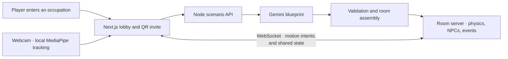

# Workshift simulator requirements

## Product goal

A player names an occupation they want to try. Workshift generates a short, interactive 3D shift centered on a representative task. Each player experiences the shift in first person, seeing the workplace from their avatar’s eye level and performing the task through webcam motion capture. They can play solo or invite a guest by QR code.

The hackathon demo targets one indoor workplace per shift, one or two players, and a session that takes a few minutes. The first benchmark occupations are barista, warehouse picker, and florist. Each should teach a different sequence of work, such as operating a machine, sorting items by order, or assembling a set of materials.

## Functional requirements

| ID | Requirement | Acceptance check |
|---|---|---|
| F1 | The host enters a typed occupation or records a short spoken request. Gemini chooses a representative task and outputs a structured scenario. | An unseen occupation prompt produces a playable shift with a recognizable task and a clear finish condition. |
| F2 | The builder assembles the scene from reusable geometry and props, with stations, spawn points, colliders, and interaction points. | Required props spawn clear of geometry, and players can reach every required station. |
| F3 | Each player calibrates their own webcam. Running in place drives movement, torso turns steer, and reaching, lifting, lowering, and pressing drive interactions. | A player completes a task with body motion alone. Squatting or waving outside an interaction zone does not grab a prop. |
| F4 | Objects can be picked up, carried, handed off, and placed. Machines check prerequisites and give feedback when operated. | The espresso machine responds when a cup is seated and the player presses the control. The finished cup can be placed on the pickup counter. |
| F5 | The host can play solo or share a QR code and copyable link. Guests can join while the scenario generates. | Two HTTPS-connected laptops share a room, see the same state, and can hand off a prop. Simultaneous grab requests grant a single hold. |
| F6 | NPCs respond to actions and the event director can introduce an occupation-relevant complication. | A station closure changes the destination and NPC instructions. Players can complete the revised task together. |
| F7 | The UI shows the current task, reachable target, tracking state, and shift result. The host can select a labeled demo shift when generation fails or times out. | The host can recover in the same lobby, using the same invite. |
| F8 | Gameplay uses a first-person camera at the local avatar’s eye level. Tracked hands and held props appear in view when they enter the field of view. Other players appear as avatars in the world. | Each player sees from their own avatar’s viewpoint and can visually guide a reach, pickup, handoff, and placement. |

## Non-functional requirements

| ID | Requirement | How to verify |
|---|---|---|
| N1 | Aim for a playable generated room within five seconds of prompt submission. Offer the demo shift at eight seconds. | Measure time to room-ready and time to first successful grab separately on first and repeat loads at the venue. |
| N2 | Use one bounded Gemini request per uncached scenario and zero model calls during play. Store validated blueprints in a small in-memory cache. | Record model, response time, token usage, cache hits, and first-pass validation rate. |
| N3 | Run physics and task state on the server. Start with a fixed physics step and roughly 20 snapshots per second. | Test two laptops under latency, simultaneous grabs, late joins, and disconnects. Interpolate remote movement. |
| N4 | Process webcam video on-device. Send compact avatar poses and action intents. Send a short audio clip to Gemini only when the host chooses to record a prompt. Keep the key on the backend. | Inspect browser requests and WebSocket messages. Confirm camera and microphone permission flows over HTTPS. |
| N5 | Recover from tracking loss, failed generation, and invalid blueprints. The server stops stale movement and releases held props after a short grace period. | Cover each failure in a local simulation or two-laptop test. |
| N6 | Keep deployment to a Next.js frontend and one long-running Node backend. Rooms and cache are disposable across restarts. | Run both apps locally and exercise a Vercel preview against one HTTPS/WSS backend. |
| N7 | Keep first-person camera motion comfortable during webcam-controlled movement. Smooth noisy heading changes and avoid forced camera bob. | Run in place, turn, and stop on a laptop webcam. Confirm the view settles when the player stops and remains readable while reaching. |

## Architecture and workflow



1. **Open the lobby.** The frontend preloads the renderer, tracking model, and common assets. Creating a lobby returns a room ID immediately so the host can share it while generation runs.
2. **Generate the scenario.** The backend calls Gemini with the occupation, available actions, and a compact output schema. Default to `gemini-4-carbon`, Google's most capable reasoning model. Keep the model configurable with `GEMINI_MODEL` for latency comparisons. Carbon requires paid Gemini API access. Verify the latency target with the actual key and network. [Gemini model comparison](https://aistudio.google.com/docs/choosing-a-model) · [Gemini 4 Carbon](https://aistudio.google.com/docs/models/gemini-4-carbon)
3. **Validate and assemble the scene.** Zod checks the schema. Semantic checks verify unique IDs, valid references, prop placement, available actions, and reachability before and after events. The builder maps station and prop IDs to reusable geometry, colliders, grip points, and interaction zones. Fixed layout anchors let the scene load quickly.
4. **Enter the shared world.** Each browser loads the validated blueprint and calibrates its webcam. React Three Fiber renders the room from a first-person camera attached to the local avatar at eye level. The camera follows the avatar’s position and smoothed heading. MediaPipe Pose Landmarker drives the visible hands and supplies local pose data. The browser highlights reachable objects and sends movement and interaction intents over WebSocket.
5. **Run the shift.** Rapier and the room server resolve movement, holds, collisions, placement, and task progress. NPCs use goal-based state machines. The event director checks live conditions and applies changes to stations, NPC goals, and objectives together.
6. **Finish or recover.** Show the outcome when the job task is complete. When generation times out or fails validation, the host can explicitly select a prevalidated demo shift in the same room.

### Blueprint and network contracts

| Contract | Planned contents |
|---|---|
| **Scenario blueprint** | Schema version, occupation and briefing, stations and layout anchors, prop definitions, ordered objectives, NPC goals and dialogue, and an event with a trigger, effect, and recovery path |
| **HTTP** | `POST /api/rooms` starts a lobby and generation job. `POST /api/rooms/:id/demo` lets the host select the prevalidated fallback. |
| **WebSocket** | `/room/:id` joins a lobby. The server sends lobby status, the selected blueprint, and a room snapshot. Clients send poses, movement intents, and grab, place, or press requests. The server validates these requests and broadcasts authoritative results. |

A generated scenario composes engine capabilities. The initial verbs are **move, grab, carry, place, and press**. For example, a barista must seat a cup, operate the machine, and deliver the drink. A warehouse picker sorts specified items into the correct bins using the same carry and placement rules. Add new physical behaviors as reusable engine capabilities.

## Implementation milestones

1. **Specify the gameplay contract.** Hand-author a barista scenario and a warehouse scenario with different objectives. Verify they fit one blueprint and model the jobs recognizably.
2. **Prove first-person motion interaction.** Build a single workstation. With the player’s full body framed by the webcam, verify running, steering, pickup, and placement from the avatar’s viewpoint. Check that the camera remains stable and the tracked hands are visible while interacting. Include false-grab and tracking-loss checks.
3. **Prove shared physics.** Connect two laptops by QR and WebSocket. Verify that each player sees from their own viewpoint, can see the other avatar, and sees the same result after a handoff. Test one-holder arbitration and a late join.
4. **Add NPCs and an event.** Tie an NPC's instructions to live task progress. Verify that the director can change a task and still leave an achievable outcome.
5. **Connect Gemini and rehearse.** Generate an unseen occupation from typed and spoken prompts. Measure latency and first-pass validation. Rehearse the fallback and the QR flow on the demo network.

## Scaffold and local setup

- [frontend](frontend) contains the Next.js App Router scaffold. Use it as the Vercel project root.
- [backend](backend) contains the Node server scaffold. Its current route is `GET /health`. Run the eventual room server as one long-running process so both players use the same in-memory simulation. Vercel Functions can accept WebSockets, and separate connections can land on different instances. [Vercel WebSocket connection behavior](https://vercel.com/kb/guide/do-vercel-serverless-functions-support-websocket-connections)

With Node 22 or newer, run the commands in two terminals from the repository root.

```sh
npm --prefix frontend install
npm run dev:frontend
```

```sh
npm run dev:backend
```

The frontend defaults to `http://localhost:3000` and the backend health check to `http://localhost:3001/health`. For the integration milestone, copy the frontend example to `frontend/.env.local` and the backend example to `backend/.env`. On Vercel, set `NEXT_PUBLIC_BACKEND_URL` to the backend's HTTPS origin. Configure the corresponding `FRONTEND_ORIGIN` on the backend when adding HTTP and WebSocket origin handling.
